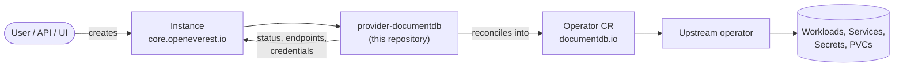

# DocumentDB Provider

> [!WARNING]
> **Pre-alpha.** OpenEverest v2 and this provider are under active development. CRD schemas,
> chart values and defaults change frequently, including in breaking ways, and there is no
> supported upgrade path between versions yet. Not for production use.

<!-- TODO(sdk): remove the pre-alpha banner and the status badge at v2 GA. -->

[](https://github.com/openeverest/openeverest)
[](https://github.com/openeverest/provider-documentdb/actions/workflows/ci.yaml)
[](https://github.com/openeverest/provider-documentdb/releases)
[](https://pkg.go.dev/github.com/openeverest/provider-documentdb)
[](LICENSE)

Run **[DocumentDB](https://documentdb.io/)**, the MongoDB-compatible document database built on
PostgreSQL, on Kubernetes through [OpenEverest](https://github.com/openeverest/openeverest),
backed by the [DocumentDB Kubernetes Operator](https://github.com/documentdb/documentdb-kubernetes-operator).

## What this is

OpenEverest providers translate a single, technology-agnostic `Instance` custom resource into
the native custom resources of an upstream Kubernetes operator — for databases, but equally
for caches, message queues, object storage, or model-serving runtimes. This repository is the
provider for DocumentDB: it owns the technology-specific knowledge — topologies, versions,
parameters, backup wiring — so that users, the API server, and the UI stay technology-agnostic.

> [!IMPORTANT]
> **This provider is not standalone.** It requires an OpenEverest installation (core CRDs and
> controller) in the cluster. Installing this chart on its own does nothing.
> See [Install OpenEverest](https://openeverest.io/documentation/current/quick-install.html).



The provider watches `Instance` resources whose `spec.providerRef.name` is
`documentdb`, and reports workload health back onto `Instance.status`. It never
manages pods directly — all lifecycle work is delegated to the operator.

## Compatibility

| provider-documentdb | OpenEverest | DocumentDB operator | DocumentDB | Kubernetes |
|---|---|---|---|---|
| `0.1.x` | `2.0.0-alpha.1` | `1.2.1` (bundles CloudNativePG `1.29.1`) | `1.0.0`, `1.0.1` | `1.32` or later |

[cert-manager](https://cert-manager.io/) is required: the operator issues its webhook and
gateway certificates with it.

## Capabilities

What you can do to a running instance through the `Instance` API. Upgrading the
provider itself is covered under [Installation](#installation).

| Capability | Status | Notes |
|---|---|---|
| Provisioning | ✅ | One topology, `replicaSet`: a primary and up to two streaming replicas |
| Horizontal scaling | ✅ | 1 to 3 instances. 3 is the default; a replica is promoted when the primary fails |
| Vertical scaling (CPU / memory) | ✅ | `resources.limits` is the pod's envelope; the operator splits it between PostgreSQL and the gateway and runs them with requests equal to limits |
| Version upgrades | ✅ | Change `spec.version`; the extension schema follows the binary (`schemaVersion: auto`). Downgrades are refused by the operator |
| Monitoring | ✅ | Prometheus metrics for ExtensionManaged monitoring classes, see [Monitoring](#monitoring) |
| TLS | ✅ | Always on: the gateway refuses unencrypted connections. See [TLS](#tls) |

Stateful workloads additionally report:

| Capability | Status | Notes |
|---|---|---|
| Persistent storage | ✅ | |
| Storage expansion | ✅ | Grow only, when the storage class allows it |
| Backups (on demand) | ⚠️ | The operator's VolumeSnapshot backups, as `documentdb.io` `Backup` resources. Not OpenEverest `Backup`s, see [Backups and restores](#backups-and-restores) |
| Backups (scheduled) | ⚠️ | `parameters.backup`, same caveat |
| Restore | ⚠️ | Into a new instance, with `parameters.bootstrap.backup.name` |

Not supported, because the operator does not offer them: point-in-time recovery, backups to
object storage, restores in place, `NodePort` services, more than three instances and
sharding. Custom PostgreSQL configuration and multi-region replication are not wired yet.

## Installation

Prerequisites: OpenEverest and [cert-manager](https://cert-manager.io/docs/installation/).

The provider chart is published as an OCI artifact:

```bash
helm install provider-documentdb \
  oci://ghcr.io/openeverest/charts/provider-documentdb \
  --version <chart-version> \
  --namespace everest-system
```

The DocumentDB operator is bundled as a chart dependency and is installed automatically,
together with the CloudNativePG operator it builds on:

- CloudNativePG goes to the `cnpg-system` namespace. If it is already installed (for example
  by `provider-cloudnative-pg`), installing a second one fails on its CRDs: set
  `operator.cloudnative-pg.enabled=false` and add `INHERITED_LABELS: core.openeverest.io/*`
  to the existing installation's operator configuration. The provider puts the OpenEverest
  labels on the CloudNativePG `Cluster`, and CloudNativePG copies them to the pods only with
  that setting; without it the Instance's pods are not counted and not monitored.
- For backups, install the VolumeSnapshot CRDs and a snapshot-capable CSI driver before the
  chart. CloudNativePG looks for the CRDs when it starts: if you add them later, restart it.
- Set `operator.enabled=false` to manage the DocumentDB operator yourself.

Upgrade and uninstall:

```bash
helm upgrade provider-documentdb oci://ghcr.io/openeverest/charts/provider-documentdb
helm uninstall provider-documentdb --namespace everest-system
```

Uninstalling the chart does **not** delete running `Instance` resources or their data.

## Usage

Verify that the provider registered itself:

```bash
kubectl get providers.core.openeverest.io documentdb
```

Create an instance:

```yaml
apiVersion: core.openeverest.io/v1alpha1
kind: Instance
metadata:
  name: my-instance
spec:
  providerRef:
    name: documentdb
  components:
    engine:
      replicas: 3
      resources:
        limits:
          cpu: "1"
          memory: 2Gi
      storage:
        size: 10Gi
```

The only component is `engine` — see [definition/provider.yaml](definition/provider.yaml).
`spec.version` and `spec.topology` are optional; the provider defaults apply.
More examples live in [examples/](examples/).

Watch it come up and read the connection details:

```bash
kubectl get instance my-instance -w
kubectl get instance my-instance -o jsonpath='{.status.connectionSecretRef.name}'
```

Connection details are in the Secret named by `.status.connectionSecretRef.name`: `host`,
`port`, `username`, `password`, a MongoDB `uri` and, in `ca.crt`, the CA that signed the
gateway certificate. Any MongoDB driver or tool connects with them:

```bash
kubectl get secret my-instance-conn -o jsonpath='{.data.ca\.crt}' | base64 -d > ca.crt
mongosh "$(kubectl get secret my-instance-conn -o jsonpath='{.data.uri}' | base64 -d)" --tlsCAFile ca.crt
```

The administrator is generated (`everest`, in the Secret `<instance>-credentials`) unless
`spec.userSecretRef` names a Secret with `username` and `password`. The gateway creates the
user when the instance is initialized, so `userSecretRef` can only be set when the Instance
is created.

### TLS

The gateway only accepts TLS connections. `spec.parameters.tls` chooses the certificate:

| Setting | Certificate |
|---|---|
| none | Issued by a self-signed issuer the operator creates for the instance with cert-manager |
| `issuer: {name, kind}` | Issued by your cert-manager `Issuer` or `ClusterIssuer` |
| `certificateSecretName` | The `tls.crt` and `tls.key` of your Secret |

Issued certificates cover the names of the gateway Service
(`documentdb-service-<instance>.<namespace>.svc`). A `LoadBalancer` address is not among
them: connect through it with `tlsAllowInvalidHostnames=true`, or provide a certificate
for your own DNS name.

### Monitoring

Add a `MonitoringDestination` of an ExtensionManaged class (for example
[monitoring-prometheus](https://github.com/openeverest/monitoring-prometheus)) to
`spec.monitoring.destinations`. The provider then publishes two scrape endpoints per pod:

- port `metrics` (9187): PostgreSQL metrics of the CloudNativePG instance manager;
- port `prom-metrics` (9188): the DocumentDB metrics of the operator's OpenTelemetry
  Collector sidecar. The provider adds the sidecar while a destination requires metrics,
  which restarts the pods one at a time.

### Backups and restores

The operator backs an instance up as a CSI
[VolumeSnapshot](https://kubernetes.io/docs/concepts/storage/volume-snapshots/) of the
primary's volume. That needs a CSI driver with snapshot support and a default
`VolumeSnapshotClass`, and the backups stay in the cluster.

OpenEverest's own backup API writes to object storage (`BackupStorage`), which the operator
cannot do, so these backups are **not** OpenEverest `Backup` resources and do not show in the
UI's backup pages; `spec.backup` and `spec.dataSource` are rejected. They are configured
with instance parameters instead:

```yaml
spec:
  parameters:
    backup:
      schedule: "0 2 * * *"   # cron; the provider creates a documentdb.io ScheduledBackup
      retentionDays: 14       # 30 when omitted
```

Take a backup on demand with the operator's resource:

```yaml
apiVersion: documentdb.io/v1
kind: Backup
metadata:
  name: my-backup
spec:
  cluster:
    name: my-instance
```

Restore by creating a new instance from a completed backup in the same namespace:

```yaml
spec:
  parameters:
    bootstrap:
      backup:
        name: my-backup
```

The users are part of the data, so the restored instance opens with the credentials of the
instance the backup was taken from. The provider copies them while that instance exists.
Backups outlive their instance until their retention expires, so a deleted instance can be
restored too, but its generated credentials are deleted with it: keep them, and create the
new instance with `spec.userSecretRef` naming a Secret with that `username` and `password`.

Whoever may create an Instance in a namespace can restore any backup in it, and with it
gets the credentials of the instance it was taken from.

## Topologies

<!-- BEGIN GENERATED: topologies -->
| Topology | Default | Description |
|---|---|---|
| `replicaSet` | ✅ | One primary and up to two streaming replicas, with automatic failover |
<!-- END GENERATED: topologies -->

## Versions

<!-- BEGIN GENERATED: versions -->
| Version bundle | Default | DocumentDB |
|---|---|---|
| `1.0.1` | ✅ | `1.0.1` |
| `1.0.0` | | `1.0.0` |
<!-- END GENERATED: versions -->

Source of truth: [definition/versions.yaml](definition/versions.yaml).

Upgrades go forward only: once the extension schema is updated, the operator refuses an
older version.

## Configuration

- **Chart values:** [charts/provider-documentdb/values.yaml](charts/provider-documentdb/values.yaml)
- **Instance parameters:** `spec.parameters` (`tls`, `backup`, `bootstrap`), defined in
  [definition/types.go](definition/types.go) and published on the `Provider` resource
  (`kubectl get provider documentdb -o yaml`). The provider validates every
  Instance against these schemas, and the UI checks the form against them as you type.
- **Admission webhook:** the chart registers one, so an invalid Instance is rejected when it
  is written. Its serving certificate is generated by the chart unless you set
  `admission.certs` or `admission.certManager.enabled`.
- **Deleting an Instance deletes its data.** The provider sets the operator's
  `persistentVolumeReclaimPolicy` to `Delete`; the operator's own default keeps the volumes.

## Development

Requires Go (see [go.mod](go.mod)), Docker, Helm, kubectl, and a Kubernetes cluster you can
reach. [dev/README.md](dev/README.md) covers the environment end to end: the recommended
local k3d setup, running against a cluster you already have, and every `dev/.env` setting.

```bash
make dev-up             # local cluster + Tilt dev environment (see dev/README.md)
make generate           # RBAC, provider spec, Helm chart sync
make run                # run the provider locally against the cluster
make test-unit
make test-integration   # chainsaw suites under test/integration/
make dev-down
```

`make help` lists every target. `make verify` fails when generated files are stale — run
`make generate` and commit the result.

The provider contract (`Validate` / `Sync` / `Status` / `Cleanup`), RBAC markers, watches,
code generation, and the backup/restore interfaces are documented once for all providers in
[PROVIDER_DEVELOPMENT.md](https://github.com/openeverest/provider-sdk/blob/main/PROVIDER_DEVELOPMENT.md).

### Layout

| Path | Purpose |
|---|---|
| `cmd/provider/` | Entry point |
| `internal/provider/` | `ProviderInterface` implementation, backup interfaces, RBAC markers |
| `internal/common/` | Component name constants |
| `definition/` | Provider identity, component types, versions, topologies, backup classes, monitoring contract |
| `charts/provider-documentdb/` | Helm chart (`generated/` is produced by `make generate`) |
| `config/rbac/role.yaml` | Generated `ClusterRole` — do not edit |
| `test/integration/` | Chainsaw suites (see its `README.md`) |
| `test/vars.sh` | Environment of the integration tests |
| `examples/` | Example `Instance` resources |
| `dev/` | Tilt dev environment, `.env` configuration, k3d cluster config |
| `.github/workflows/` | CI: lint, build, unit and integration tests, release |
| `.github/dependabot.yml` | Daily PRs for new operator releases (Go module + Helm subchart) |

### Testing

- **Unit tests** — `make test-unit`.
- **Integration tests** — chainsaw suites under `test/integration/`. They run without the
  DocumentDB operator and play its part by patching statuses. See
  [test/integration/README.md](test/integration/README.md).
- **CI** — `.github/workflows/ci.yaml` runs lint, build, unit tests, generated-file
  verification, Helm lint, and each integration suite on every pull request.

## Troubleshooting

```bash
kubectl logs -n everest-system deploy/provider-documentdb -f
```

| Symptom | Where to look |
|---|---|
| `Instance` stuck in `Creating` | `kubectl describe instance <name>` conditions, then the provider logs |
| No `Provider` resource in the cluster | Is the chart installed? Check the provider deployment logs |
| `Instance` ignored entirely | `spec.providerRef.name` must be `documentdb` |
| Operator resource created but no pods | `kubectl describe documentdb <name>` and the `clusters.postgresql.cnpg.io` of the same name — the failure is upstream |
| Instance Ready but `status.components` empty, no metrics | CloudNativePG lacks `INHERITED_LABELS: core.openeverest.io/*` (see [Installation](#installation)) |
| Backups fail with `missing VolumeSnapshot CRD` | Install the VolumeSnapshot CRDs, then restart the CloudNativePG operator |
| Backups stay `pending` or fail | The storage class needs a CSI driver with snapshot support and a default `VolumeSnapshotClass` |

## Contributing

Issues and pull requests are welcome. See
[PROVIDER_DEVELOPMENT.md](https://github.com/openeverest/provider-sdk/blob/main/PROVIDER_DEVELOPMENT.md)
and the [OpenEverest Code of Conduct](https://github.com/openeverest/openeverest/blob/main/CODE_OF_CONDUCT.md).

## Security

Report vulnerabilities per the
[OpenEverest security policy](https://github.com/openeverest/openeverest/blob/main/SECURITY.md).
Please do not open public issues for security reports.

## License

Apache License 2.0 — see [LICENSE](LICENSE) for details.
